# Game Framework — Roadmap
Release target: v0.5 The AI (defined 2026-10-04, proven by Glyphtender beta) — musts 2/6 · v0.4.0 The Table released 2026-10-04

## v0.1 — Game UI kit  ✅ released (prototype) 2026-09-28
Goal: any game can get good-looking, standard menus, settings, dialogs and HUD in one of 5 styles, built passively by the `game-ui` skill. Design: `design/ui-kit.md`.
- ✅ F01 🧱 Parts + style engine — must:prototype · sprint 1
  what: 5 layout boxes (Screen, Panel, Stack, Row, Grid), the controls, style.json → CSS variables at runtime, accessibility floor, preset test
- ✅ F02 🎮 5 style presets (Clean, Cozy, Cartoon, Pixel, Neon) — must:prototype · needs: F01 · sprint 1
  why: one structure, many skins → every game looks finished from day one → less look-and-feel back-and-forth
- ✅ F03 🧱 Screen stack + transitions — must:prototype · needs: F01 · sprint 1
- ✅ F04 🎮 Built screens: menu, list-driven settings, pause, dialogs, loading, flow/results, lobby, HUD frame + pieces — must:prototype · needs: F01, F03 · sprint 2
- ✅ F05 🔧 Gallery app (every catalog entry × every preset; phone + desktop screenshots; style switcher) — must:prototype · needs: F01, ~F04 · sprint 2
- ✅ F06 🧱 `game-ui` skill + recipe catalog + wiring into /develop and /define — must:prototype · needs: F04, F05 · sprint 3
- ✅ F07 ❓ Try it: pick a game + a real screen to rebuild; adjust from what we learn — needs: F06 · sprint 3

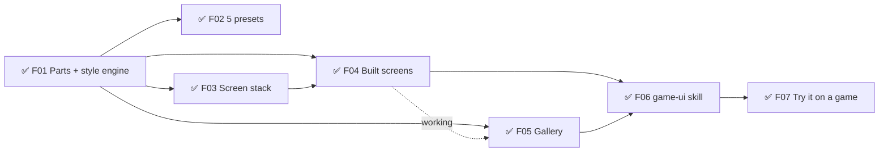

## v0.2 — Dev Kit module + kit pass  ✅ released (prototype) 2026-09-29
Goal: every web game gets the in-game Dev Kit (` key) from the framework, and the UI kit closes the gaps Roll Better found.
- ✅ F08 🧱 Dev Kit module (`devkit/`: panel, Save/Copy for Claude, release switch, colour tab, game-tab API, installer, release check) — must:prototype · sprint 4
  why: every game gets the same tuning tools on day one → taste calls happen by eye in the game, not by description
- ✅ F09 🔧 Roll Better on the framework Dev Kit (table felt becomes its game tab) — must:prototype · needs: F08 · sprint 4
- ✅ F10 ✨ Kit pass 0.2: MainMenu item list, Results dim, toast placement, Bar width, PlayerChip xs, pinned-part scale helper, check-ui scans game CSS — must:prototype · sprint 4
- ✅ F11 🔧 Roll Better on kit 0.2 (remove its stitches) — must:prototype · needs: F10 · sprint 4

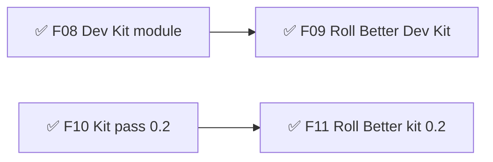

## v0.3 — Rooms, Dev Kit 0.5, kit 0.2.15  ✅ released 2026-10-03 (v0.3.0 → v0.3.1, built through Glyphtender)
Shipped while Glyphtender used them (backfilled 2026-10-04): **Rooms** module (online rooms, seats, rejoin, bot takeover, per-player views — harvested from Roll Better, proven in Glyphtender) · **Dev Kit 0.3–0.5** (snapshots, bug capture, screen previews, search + sections) · **UI kit 0.2.3–0.2.15** (screen stack, carousel that loops, cards that breathe, no orphans, PlayerChip floatUps…).

## v0.4 — The Table  (proven by Glyphtender v0.6)  ✅ released 2026-10-04
Goal: the foundation every board/tabletop game stands on — Game core + events, Turns & flow, Zones & pieces, drag referee, Hand view, seats & per-seat views — built for online play and AI (local and online). Design: `design/table.md`. Each feature is built here first and switched on in Glyphtender the same sprint (its F29–F36); Roll Better is the second-game proof after.
- ✅ F12 🧱 Game core: rules contract (setup, legalActions, check, apply → state + events, isOver, viewFor), replayable move record, fast mode, seeded random — must:prototype · needs: Glyphtender F29 (golden games) · built in table/ (kit 0.1.0), switched over in Glyphtender sprint 09
- ✅ F13 🧱 Event stream: events with visibility; listeners for screen, sound, stats, achievements, online replay — must:prototype · needs: F12
- ✅ F14 🧱 Turns & flow: stack of named levels, who may act (one · some/all · everyone), order list from the rules, ends-when, response windows; presets — must:prototype · needs: F12
- ✅ F15 🧱 Zones & pieces: zones (nesting, inherited owner/visibility), pieces with stable ids, owner field, shared vs local states, accepts by kind — must:prototype · needs: F12
- ✅ F16 🧱 Drag referee: one acceptance answer → glow, piece reaction, nope, cursor; phones show valid zones on pick-up; server re-check — must:prototype · needs: F14, F15
- ✅ F17 🧱 Hand view: zone layouts with presets (rack first; fan later) — must:prototype · needs: F16
- ✅ F18 🧱 Seats & per-seat views: one seat model (human/bot, local/online), viewer seat for pass-and-play, per-seat views + per-seat events in Rooms (replaces broadcast-to-all), leak tests — must:prototype · needs: F13, F15
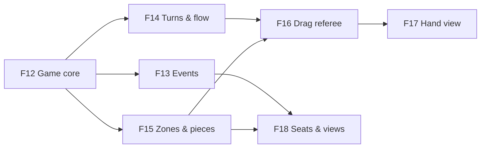

## v0.5 — The AI  (proven by Glyphtender beta, its v0.7)  ✅ released 2026-10-23 (v0.12.0)
Goal: any turn-based game can put a fair, human-feeling AI in any seat — local or online — with personalities Muzzy tunes in the Dev Kit and proves by watching behaviour across hundreds of games. Design: `design/ai.md`. Built here first and switched on in Glyphtender the same sprint (its F38–F47).
- ✅ F19 🧱 Brain: personality + skill data, see (view only) → imagine hidden → readings → mood shifts → goal roll → candidates → score (main goal + nudge) → choose like a person → explain note; seeded; game plug shape — must:beta · needs: F12, F18 · Glyphtender sprint 14 · built 2026-10-04 (ai kit 0.1.0)
- ✅ F20 🧱 Fuzzy beliefs: estimates with confidence that decays / rises from the seat's own events; drift; rebuilt from events (rejoin-safe) — must:beta · needs: F19, F13 · built 2026-10-04 (stateless beliefs.ts)
- ✅ F21 🧱 Pace + background thinking: Web Worker runner, time budget, think-time + speed presets (Slow · Normal · Fast · Instant), server runner inside the room — must:beta · needs: F19
- ✅ F107 🧱 Emotes (Muzzy 2026-10-05: "players send predefined messages (MTG Arena / Hearthstone style); the AI module plugs in its triggers + frequency"): a framework module — a short preset phrase set in content/, a picker, a speech bubble by the seat (UI kit part), mute per opponent, a spam limit, online through the rooms server — the base AI banter speaks through (Muzzy 2026-10-23: "Emotes first") — must:beta · needs: F13 · sprint 26
- ✅ F22 🧱 Banter: moments from events → line picker (chattiness, cooldown, no repeats), spoken through the emote module (its bubble, its mute) — must:beta · needs: F19, F13, F107
- ✅ F23 🔧 Dev Kit AI tab: personality editor (range sliders, goal order, nudge, shifts, skill, bio/banter) saving to content/ai/, and "watch a game" with decision notes + belief meters — must:beta · needs: F19, ~F20 · built 2026-10-04 (Dev Kit 0.6.0, devkit/kit/ai: game plugs in with aiTab(DevKitAi): files as data + validate / watch / runCheck callbacks; Run check opens the F24 report; first game: Glyphtender F41). Not yet: banter lines, pace.json, pause/step in Watch
  why: Muzzy tunes personalities by eye in the game, not by description
- ✅ F24 🔧 Arena + Personality Check: N AI-vs-AI games (Node + Dev Kit), behaviour meters, feel targets green/red, tell-apart grid, win-rate grid, skill ladder, report page — must:beta · needs: F19, ~F21 · sprint 26 (ai 0.3.0 arena + npm run ai:arena, Dev Kit 0.23.0 Run check in a worker)
  why: proves a personality *feels* like itself (behaviour), not just that its numbers are set
- ✅ F25 🔧 "What wins?" report: which situations predict winning, from self-play — should · needs: F24
- ✅ F26 🔧 Auto-tuner: suggests slider values that hit a personality's feel targets — could · needs: F24
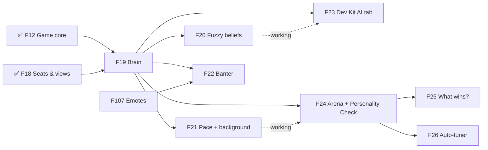

## v0.6 — Audio  ✅ released 2026-10-10 in framework v0.5.0 (proven by Glyphtender v0.6.0)
Goal: any web game gets sound by naming its moments — content/audio.json says what they sound like, Muzzy tunes and swaps them in the Dev Kit Sound Board, and the standards (volume groups, variation, limits, phones, online catch-up) come for free. Design: `design/audio.md`. Defined with Muzzy 2026-10-09.
- ✅ F27 🧱 Audio engine + rules: pure planner (variants, random pitch/volume, voices + cooldown + priority, pitch ladder, stale/catch-up drop), Web Audio engine (unlock, buses → limiter, silent switch, hidden/interrupted = drop not queue, mono, snapshots + ducking), loader (decode sfx, stream music), content/audio.json config + validation, log (window.__audioLog), React helpers, installer; audio-setup skill → points at the module — must:beta · needs: —
  status 2026-10-09 (Glyphtender sprint 19): built in audio/ (kit 0.1.0), tests pass (90) — planner, engine, loader (decode only), config, log, settings, React helpers, installer. Left: music streaming via <audio> (moved to F28), audio-setup skill pointer, the Glyphtender proof
- ✅ F28 🧱 Music + mix: streaming long music/ambience through <audio> (F27 decodes everything for now), synced layers, gapless loop points, crossfades, stingers, rests after N loops, snapshot/duck timing — must:beta · needs: F27
- ✅ F29 🎮 UI kit Settings → Audio tab standard: Master · Music · Ambience · Effects · UI · Mute everything · Mute in background · Mono, dB-feel sliders, wired to the engine — must:beta · needs: F27
  status 2026-10-09: ui-kit 0.4.1 standard rows built, tests pass; the dB-feel curve + wiring are the audio module's useAudioSettings. Left: the Glyphtender proof
- ✅ F30 🔧 Dev Kit Sound Board: sound list + ▶ / ▶×5, every knob as sliders (live, Save, ↺), files (drop to replace → public/audio, waveform trim/loop handles), A/B, ▶ in context (game adapter), mixer + meters, play/drop log, credits nudge; binary save endpoint (public/audio only, dev only) — must:beta · needs: F27, ~F28
  why: Muzzy tunes sound by ear in the game ("I should be able to change sounds, tweak them")
- ✅ F31 🔧 Audio check script: loudness report + convert/normalize to MP3 (ffmpeg-static) + onset check (a tap/ui sound that takes > 15 ms to start is trimmed to its onset — Glyphtender B026), used by the Sound Board's drop — should · needs: F27 · sprint 24
- ✅ F32 🔧 Dev Kit Moments + feel presets (Muzzy 2026-10-09): Screens → pick a screen → its Moments (score pop, two-birds, tangle, reveal winner…) → ▶ fire / 🔁 loop while sliders change (feel tiers, timings, sound); each moment has a 3-style preset picker (research the styles other games use first — e.g. Soft · Balanced · Punchy) that sets all its values, then every slider stays tweakable — must:beta · needs: F27, ~F30
  why: Muzzy picks feel by watching it loop, not by reading numbers; presets are the easy start (like the UI kit's 5 styles)
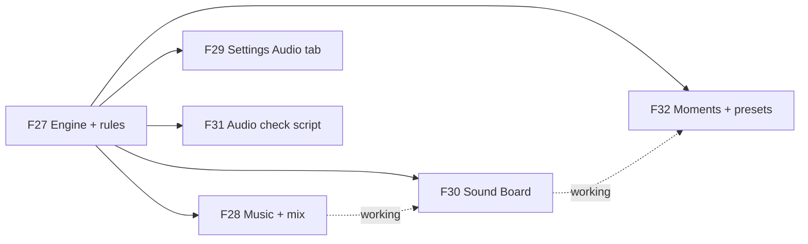

## v0.7 — Drag carry styles  (proven by Glyphtender v0.11)  ✅ released 2026-10-10 in framework v0.6.0
Goal: any game picks, per drag type, how a dragged piece is carried, what its home shows, how the drop ends and what the target shows — all previewable live in the Dev Kit. Tiles/objects in zones first; card hands (insertion marker, make room) next.
- ✅ F53 🧱 Carry styles (ui-kit kit/drag/): carried solid|ghost + lift · origin solid|ghost|empty · valid landing settle/turn solid/fly from origin · invalid return fly back/fade · presets A Pick it up · B Lift, mark home · C Aim · D Float; Dev Kit Tuning dropdown field — should · Glyphtender sprint 23 (its F63) · built 2026-10-10 (ui-kit 0.5.0, Dev Kit 0.10.0)
- ✅ F54 🧱 Target feedback: highlight · ghost preview · insertion marker · make room (FLIP) · tether · magnetic snap — should · needs: F53 · Glyphtender sprint 23 (its F64) · built 2026-10-10 (ui-kit 0.6.0)

## v0.8 — Dev Kit Select Mode  ✅ released 2026-10-15 (framework v0.10.0, Dev Kit 0.16.1 — proven by Glyphtender v0.11.0; F57 3D picker stays for later) · defined 2026-10-14
Goal: click a thing in the game — or a menu button, switch, tab… — → its knobs (Tuning · UI style · Text · Sound) in one place → change them → Save. Design: `design/select-mode.md` · discovery: `research/devkit-select-mode.md`.
- ✅ F55 🔧 Select tab + picker: select mode, pink hover / picked outlines + outline slider, the picked object's knobs from the real editors grouped by its sections, recently-on-screen list, pick + slider remembered — should · Glyphtender sprint 29 (its F86)
  why: Muzzy sees something he wants changed → one click → every knob for it → no hunting through tabs and files
- ✅ F56 🔧 ~~+ Add a knob / ✕ remove~~ (taken out in 0.16.0 — Muzzy 2026-10-14: a click should simply show everything; the game's test checks every setting is on some object: unlistedSettings), pick forgotten when the Dev Kit closes, desktop panel tucks to a bar while selecting (0.15.1), checkSelectMap (unknown keys shown red + a game test), Copy for Claude of a pick — should · needs: F55 · Glyphtender sprint 29
  why: the object → knobs list grows while playing → it gets right over time without anyone planning it perfectly
- ✅ F58 🔧 UI kit parts in Select: a "style" knob kind (style.json token names, shared by every part of that kind) shown by the Color tab under a pick; the Color tab also edits the non-colour values (corners, outline, shadows, press feel, timings, menu sizes — styleValues.ts, slider / dropdown / box); things in an [inert] screen never picked; outlines never drawn over the Dev Kit panel; phone pick waits for the tap to finish — Dev Kit 0.15.0 · should · needs: F55 · Glyphtender sprint 29 (its F88), Muzzy 2026-10-14: "click on a button, or a toggle and update the settings for it"
- ⏳ F57 🔧 3D picker (raycast + 3D outline, same tab) — could · needs: F55 · when a 3D game needs it
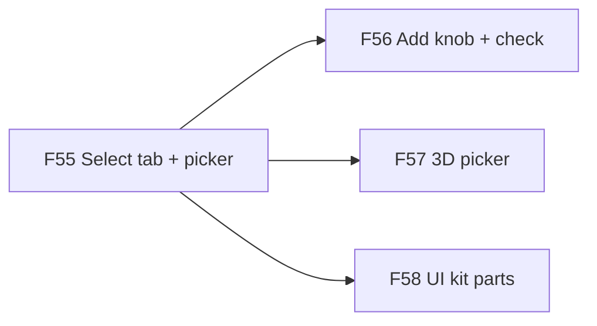

## v0.9 — Every game wired the same  (proving ground: Goops, then Glyphtender) · planned 2026-10-18
Also covers the 2026-10-18 reliability review (`~/.claude/config/bmuz/reviews/2026-10-18-reliability/PLAN.md` — hooks, scripts, CI, evals, session hygiene: F68–F72).
Goal (Muzzy 2026-10-18): "BMUZ architects games in a consistent way that allows for the Framework and all of our tools to function without regression." Why: Goops got the Dev Kit installed with none of its hooks — nothing live, no pause — and no test noticed; the catalog already said "live via liveTuning". Rules on paper drift; this milestone makes the right wiring automatic, tested and inherited. Spec: `~/.claude/config/bmuz/MODULE-CONTRACTS.md`.
- 🔨 F59 🧱 Game core: live content by default (the Dev Kit's Vite plugin makes every content/tuning import live), rules clock + looks clock (`gameClock`: game timers on the rules clock), seeded mode, adapter base, error catcher — thin: no rules, no rendering — must · building in Goops (Dev Kit 0.18.0), then pulled out as its own small module
- 🔨 F60 🔧 Dev Kit Time tool: ⏸ Full pause (rAF + CSS/Web animations + audio held, game timers via the adapter) · ◐ Half pause (rules clock stopped, looks running; shown only when the game supports it) · greyed out online — then slow motion + step one frame on the same clock (should) — must · needs: F59 · building in Goops
- ✅ F61 🧱 Conformance pack: each module ships tests of its own promises (Dev Kit: every tuning file live, both pauses, snapshot round-trip, hotkeys skip text boxes · UI kit: no overlap / clipping / 44 px targets at every size · Audio: quiet on full pause · Table/AI: replay + bot stops on half pause); one command `check:framework` in every game's check:full and /deliver; each module README gets "What a game must provide" — must · needs: F59, F60 · sprint 5
- 🟢 F62 🔧 Goops passes the pack — must · needs: F61 · includes: Goops gets `check:framework` (it has neither the script nor the checks yet) and the GitHub checks workflow (F70); its Settings `version` row shows the placeholder (no `info` text, found by F76)
- ✅ F63 🔧 Glyphtender passes the pack (its gaps become a list → its roadmap) — must · needs: F61 · sprint 09 (all 6 pieces newest on Glyphtender dev/framework-checks, ships at its /deliver; half pause = its F89, a known gap; Dev Kit 0.20.2) · Roll Better when it comes off the shelf
- ⏳ F64 🧱 Starters: `starters/realtime` (from Goops) + `starters/turn-based` (from Glyphtender) — tiny playable games with every module wired and the pack green on day one; /define copies one, the TDD only describes what's different — should · needs: F62, F63
- ⏳ F65 🔧 Framework test game: the starters run the pack in the framework on every module change, BEFORE an update reaches a game — should · needs: F64
- ✅ F67 🔧 Lesson audit (BMUZ side) — first pass done 2026-10-18: ~45 candidates in `~/.claude/config/bmuz/reviews/2026-10-18-reliability/HOOK-CANDIDATES.md` (⭐ = best value; build `plan-lint.mjs` first): every checklist line in the BMUZ skills (develop ~40 lessons, game-ui, PROJECT-FILES) sorted → now automatic (delete) · becomes a pack check · becomes a default/installer step · stays prose (judgement only); skills get shorter, not longer — must · needs: F61
- ✅ F68 🔧 BMUZ hooks (do FIRST — touches only ~/.claude, no clash with the Goops helper): Muzzy's "never" rules as hard blocks (deny rules / PreToolUse: reset --hard, force-push, branch delete, his Chrome, Gmail) · /develop's skill registers a Stop gate (check:fast when code changed since the last green run; fast, timeout, stop_hook_active guard) · git commit refused when the typecheck fails · push/deploy to a live branch refused unless /deliver's smoke pass file exists · edits in src/ui → check-ui on that file. Show Muzzy each hook in plain words; prove each one blocks — must · needs: — · plan: ~/.claude/config/bmuz/reviews/2026-10-18-reliability/PLAN.md · sprint 5
- ✅ F69 🔧 Scripts for fragile procedures: module install/update (runs the module's contract check), version bump, /save, /deliver → scripts (or saved Workflows); the skills shrink to "run it; if it fails, read the message" — must · needs: F61
- ✅ F70 🔧 CI backstop: every game repo's GitHub Actions run check:fast + the conformance pack on push — should · needs: F61
- ✅ F71 🔧 Evals for the BMUZ skills (BMUZ as a plugin, `claude plugin eval`): a few cases per key skill (e.g. "install the Dev Kit into a fixture game" → contract check ran, main.tsx wired); run after skill edits + model updates; Bash cases need WSL2 on Windows; costs usage per run — should · needs: F68, F69 · sprint 08 (6 cases, ~$1.40 a run; recipe: ~/.claude/config/bmuz/evals/README.md)
- ✅ F72 🔧 Session hygiene in BMUZ: one feature per session (or per helper), STATE written between; autonomous runs start a fresh session at each feature boundary instead of the 80% checkpoint — should · needs: —
- ✅ F73 🔧 Standard hand-off card (Muzzy 2026-10-18: "I never want to see it any other way going forward! BMUZ standardizes the experience of designing as a non-technical person."): every turn with work ends with the card in `~/.claude/config/bmuz/templates/handoff.md` (Done · You'll see · Try it links · Proof · Questions · Next `/command` — what it covers) or the progress line; a Stop hook sends anything else back — must · needs: F68 · sprint 5
- ✅ F74 🔧 Self-improving loop (Muzzy 2026-10-18: "when finishing a milestone, analyze it all and see if any lessons or structure/methods can be ported to BMUZ/Framework in an ever-flowing self-improving loop"): /deliver of a milestone runs a retro — what went wrong / was repeated / was built game-only that others need → each becomes a hook, a check, a script, a framework module piece, or a checklist line (BMUZ-PLAN rule); a Stop check makes sure the retro ran and its items landed somewhere — must · needs: F67
- ✅ F66 🔧 "Framework health" row on each game's planner page (module versions + pack results) — could · needs: F61 · sprint 08 built it; Muzzy 2026-10-19: too technical → sprint 09 redoes it in plain words
- ✅ F75 🔧 "Done" means reviewed + fully checked: guard-git's `Fxx: done` also needs STATE's `Reviewed through` and `Last full check` to cover the feature (today the review and full check are honour-system; F72 only checks that STATE changed) — should · needs: F72 · from the Oct 18 list audit (2026-10-19)
- ✅ F76 🔧 Settings-row check: every Settings row that's switched on is read by the game — a UI kit conformance check (Glyphtender once shipped 12 dead rows) — should · needs: F61 · from the Oct 18 list audit
- ✅ F77 🔧 "Update available" at session start: a game whose framework pieces are behind the newest hears it when the session starts, not only when a UI task remembers to compare VERSION files — should · needs: — · from the Oct 18 list audit
- ✅ F78 🔧 Safety guards: no secret (.env…) staged on ANY commit (today only /save refuses) · ask before `git checkout <file>` / `git restore` wipes uncommitted work (Goops F17 lost a file) · `.claude/worktrees/` + `.planning/ppp.html` added to a game's .gitignore by itself · `.playwright-mcp/` cleaned up by itself — should · needs: F68 · from the Oct 18 list audit
- ✅ F79 🔧 One check run at a time in every game: Glyphtender's check-all.mjs gets the template's lock (the template has it, the game's copy predates it) — should · needs: — · from the Oct 18 list audit
- ✅ F80 🔧 Everything triggers (Muzzy 2026-10-19: "'only runs when it remembers' is a bad thing. 'always runs because it triggers' is much more solid"): go through EVERY BMUZ skill line by line (discover, define, sprint, develop, deliver, save, bug, ppp, play, sketch, checkup…) and sort each step: ① automatic (a script/hook does it) · ② judgement but checked (a trigger refuses to move on until it's on record, like F75) · ③ judgement only (kept rare). Every "remembered" step → ① or ②, starting with /save + /deliver (every step inside their scripts; ending a session with unpushed work becomes a guard, not a reminder). Standing rule: a new "always do X" line names its kind, and the milestone look-back flags remembered-only lines — should · needs: F75, F78 · sprint 12
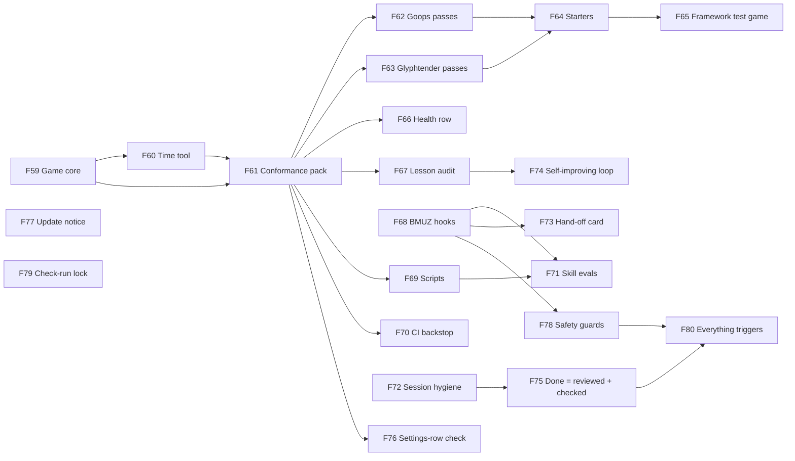

## v0.10 — A whole studio around one designer  ✅ released 2026-10-21 (v0.11.0)  · planned 2026-10-19 (from F80's studio gap list)
Goal (Muzzy 2026-10-19): "If a real indie studio would do something, we should too… simulate having a full team of checks and SOPs… as automated as possible because the people who use BMUZ (me) won't KNOW what to do." Each feature is one studio role's routine (producer, QA, release engineer, tech lead…), done by a trigger, never by memory. Source: `~/.claude/config/bmuz/reviews/2026-10-19-triggers/AUDIT.md` §4 (ranked by what would hurt a solo designer most). Already landing in F80: release checklist inside release.mjs, live check after a deploy, rollback, the look-back trigger. Order is Muzzy's call at /sprint.
- ✅ F81 🔧 Producer's eye at every session start: sprint age ("Sprint 07 is 9 days old, the last 3 took ~4"), days to the milestone's `target:` date + musts done, features stuck in 🔨/🎛️ with no commits for 7+ days, open 🙋 tasks + `Ask Muzzy:` count, fixes waiting for Muzzy's check; plan-lint flags ⏳ features that became ready; archive-sprint refuses without a 3-line mini retro (went well · went wrong · change) — should · gap ranks 4, 5, 11 · sprint 13
- ✅ F82 🔧 Is the live game up? Session start does a 3-second check of STATE's Live URL and says "the live site is DOWN" only when it is; live-check.mjs also pings the room server's health URL — should · needs: F80 · gap rank 1 · sprint 17
- ✅ F83 🔧 Stage-release checks (alpha / beta / 1.0): release.mjs refuses a stage release without `.planning/archive/release-checks/<stage>.md` naming the devices tried, a first-time player who played without help, store-page screenshots newer than the last stage, TDD §7 compliance for the platform (privacy, age rating), no stand-in art left (beta+), and at 1.0 the name/trademark check + press kit — should · needs: F80 · gap ranks 7, 13, 16 · sprint 17
- ✅ F84 🔧 Patch notes players can read: release.mjs writes the bullets to CHANGELOG.md + `.planning/archive/releases/vX.Y.Z.md` (ready to paste into itch) and refuses without them — should · needs: F80 · gap rank 9 · sprint 16
- ✅ F85 🔧 Dependency + licence audit: /checkup runs `npm audit`, `npm outdated` and a licence summary per game (monthly), names high-risk packages and GPL code in a shipping game in plain words — should · gap rank 8 · sprint 16
- ✅ F86 🧱 Saves module (Muzzy 2026-10-19: "saves would be the module, versioning is a feature of that module"): a framework module games copy in for saving/loading; every save carries a version stamp and each release adds a small upgrade step for older saves; ships a check:fast test that loads a saved game from every past release (`tests/saves/*.json`), so an update can't wipe progress. Researched first (`.planning/research/saves.md`): this is layers 0 + 1 (core + save code / storage health); layers 2–8 are F93–F99. (Only Goops' progress save carries a version today; Glyphtender has a one-off marker, Roll Better saves ids only) — should · gap rank 10 · sprint 15
- ✅ F87 🔧 QA routine: plan-lint requires a `Check:` line under every sprint feature and a `Checked:` note before `Fnn: done`; an open P1 older than the sprint start that isn't a sprint task is flagged; /play's watch mode writes a playtest log (`.planning/research/playtests/<date>.md`) a stage release asks for — should · QA lead rows · sprint 13
- ✅ F88 🔧 Quality bars in check:framework: text contrast, a reduce-motion setting, a volume setting when the audio module is in, nothing touching a card's edge, cards that don't grow mid-sequence (CLAUDE.md's "breathing room" rule, now checked) — should · gap rank 12 + art/audio rows · sprint 14
- ✅ F89 🧱 Crash reports from players: a crashes module — errors caught in the game, sent once per kind per session to a small worker of its own on the game's Cloudflare that groups them; hidden source maps + a local command for real file lines; session start says "3 new errors from players since last time"; on by default with a Settings switch (Muzzy 2026-10-22). Research layer 1 (`.planning/design/crashes.md`) — could · gap rank 6 (large) · sprint 25
- 💤 F105 🧱 Crash reports, layer 2: reports kept while offline across sessions, a private web page (mark fixed, "came back" flags), freeze / long-stall signals, the rate-limit binding — could · needs: F89
- 💤 F106 🧱 Crash reports, layer 3: charts over time (Analytics Engine), a player "report a bug" button, native crashes from app-store / desktop builds — could · needs: F105
- 💤 F90 🔧 Coding standards as lint rules: no hard-coded tuning numbers in game logic, no React state set inside useFrame — could · gap rank 14
- 💤 F91 🔧 Localization readiness: player text in JSX flagged toward content/text/en.json (games that opted in), a +40% "pseudo-language" pass reusing the cut-off check — could · gap rank 15
- 💤 F92 🔧 Tech lead's routine: a new content/ file or top-level src/ folder without a TDD change → sent back; a performance budget line in check:full (bundle size vs a budget in content/) — could · tech lead rows
- ✅ F93 🧱 Saves: run resume — autosave at natural break points (end of turn / wave), "Continue?" on launch, the run deleted when it ends (research layer 2) — should · needs: F86 · sprint 18
- ✅ F94 🧱 Saves: seed + move log — a run saved as its seed + moves and rebuilt by replaying them; gives replays and daily challenges; needs rules with no hidden randomness (research layer 3) — could · needs: F86 · sprint 20
- ✅ F95 🧱 Saves: online rejoin — room id + seat token kept so a player who closed the tab gets back into the match, with the rooms kit (research layer 4) — should · needs: F86 · sprint 18
- ✅ F96 🧱 Saves: cloud via link code — a short code copies the save to another device, on our own Cloudflare (KV/D1), no accounts; progress merged by each field's rule (F86), offline first; privacy note + delete my data (research layer 5) — should · needs: F86 · sprint 19
- 💤 F97 🧱 Saves: app stores + Steam — the same saves on Capacitor (Preferences), Electron (userData files) and Steam Cloud, behind the same API (research layer 6) — could · needs: F101 · waits for the store run-through (Ideas; Claude's call 2026-10-20: built against real store builds, not stand-ins)
- ✅ F98 🧱 Saves: checked leaderboards — the server replays seed + moves to verify a score, never trusts a sent one (research layer 7) — could · needs: F94, F96 · sprint 20
- 💤 F99 🧱 Saves: Unity port — the same save format in C# (persistentDataPath files) (research layer 8) — could · needs: F101 · waits for the first Unity game (Claude's call 2026-10-20)
- ✅ F100 🧱 Rooms: a match waits until it ends — the room's seats + game state kept in the Durable Object's storage, so a player can rejoin hours later and a server restart doesn't lose the match (Muzzy 2026-10-20: "until the match ends") — should · needs: F95 · sprint 19
- ✅ F101 🧱 Saves: ready for any platform — one storage switch for the whole kit, saves opened from a slow (async) storage at start-up then read instantly, writes in the background and forced out on hide/quit, the save format written down for any language (FORMAT.md); the seams F97 / F99 plug into later — should · needs: F86 · sprint 21
- ✅ F102 🧱 Version module (Muzzy 2026-10-20: "version number visibility is important in all games… should be a built in process, possibly a 'version' framework module that gets added to every game"): one source (version.json, /save bumps it) → a Vite plugin (define + `<meta name="app-version">`), one "vX.Y.Z.B" label on the main menu, the bottom of Settings and the Dev Kit's bug files, an e2e helper that refuses a stale build / cached service worker, check:framework checks the wiring (from Goops' own copy) — should · sprint 22
- ✅ F103 🔧 Kit fixes from Goops: confirm boxes work without `...kitScreens`, Bar row "at most its share" + dock tight padding as kit options, the Dev Kit check warns when the PAUSED pill sits on the game's HUD — should · sprint 22
- ✅ F104 🔧 Portrait only, said once (sprint 22 retro + F103 proof: check:framework checked Goops sideways though Muzzy said "the game is not expected to function in horizontal/landscape mode. ever."): content/ui/style.json `orientation`, honoured by check:framework, the screenshot script, the Dev Kit's phone checks and the helper briefs — should · sprint 23
- ✅ F108 🔧 Kit pieces for shop / upgrade screens (Goops' session 2026-10-23, its F34 Upgrades screen): a `success` colour in all 5 styles, Card `tone="success"` (same size), Modal `headerAction` prop, Card `locked`, Neon `danger` glow matching `primary`, MenuHeader title that shrinks before wrapping and never splits a word — should · sprint 26
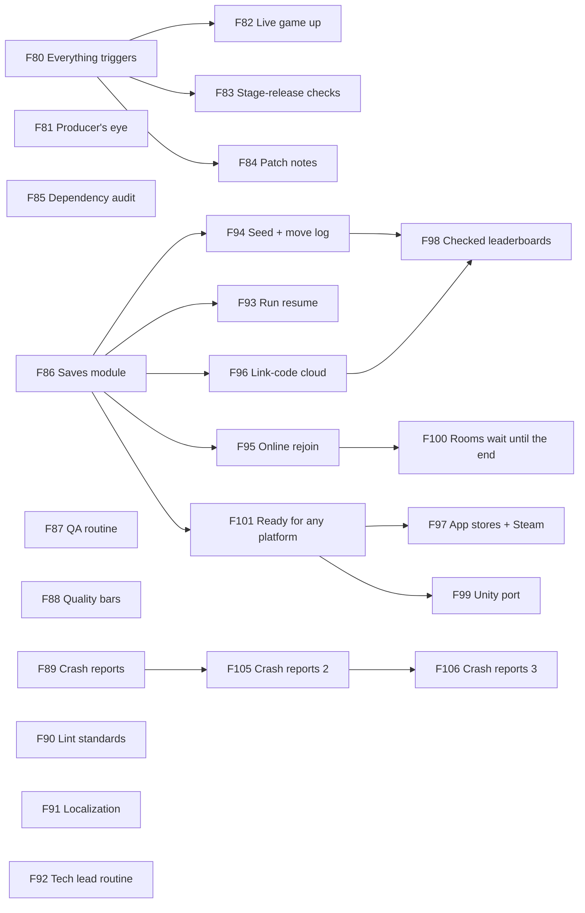

## v0.11 — Games take the AI  ✅ released 2026-10-23 (v0.13.0) · planned 2026-10-23
Goal (Muzzy 2026-10-23, "a go"): the pieces a game still hand-builds before it can take emotes, banter and the AI check — so Glyphtender's session can install them in one go.
- ✅ F109 🔧 Tappable seat row: the UI kit's PlayerSeats can make each seat a button (tap → the emote picker on yours, Mute on a rival's), with the muted mark on the chip and the emote seat tags — the emotes module's `<EmoteSeats>` wires it; Glyphtender's hand-built SeatEmotes.tsx no longer needed (v0.5 look-back) — should · needs: F107 · sprint 28
- ✅ F110 🔧 Module Settings rows register themselves: each module ships its rows + what counts as "read" in one manifest the UI kit's Settings check reads, so a new module (crashes, emotes, ai…) needs no UI kit change (v0.5 look-back) — should · needs: F107, F22 · sprint 28
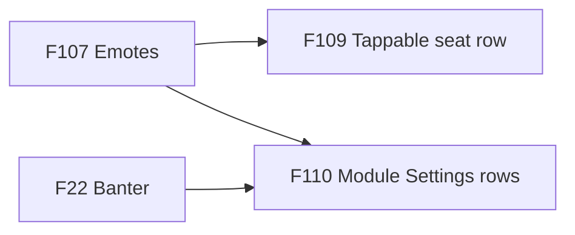

## v0.12 — Story bubbles + clean installs  ✅ released 2026-10-24 (v0.14.0) · planned 2026-10-23
Goal (Muzzy 2026-10-23, "go"): a talking bubble for story moments (Goops F09 first), and modules that never break a game's own checks.
- ✅ F111 ✨ Talking bubble: a UI kit speech bubble that grows from its tail, types its text out with rests, fizzes its outline as a speech wave and pops it per syllable, squelches while waiting; a plain style without the wave; values in content/, live in the Dev Kit (Goops sketch S9, Muzzy-approved feel) — should · needs: F107 · sprint 29
- ✅ F112 🐞 Modules never trip a game's checks: install-module adds the module folder to the game's eslint ignores; the Dev Kit's checks skip every src/ folder with a VERSION file (Goops' report + F110's find) — must · sprint 29
- ✅ F113 ✨ Report rows one at a time: Victory / GameOver `reveal` (ms per row, the Results stagger, card full size from the start, `onRevealed`), a `<StatList stats reveal />` block a Modal can hold, per-row `tone` (danger / success) — Goops F41 payslip (its session's request, 2026-10-23) — should · needs: F107 · sprint 29
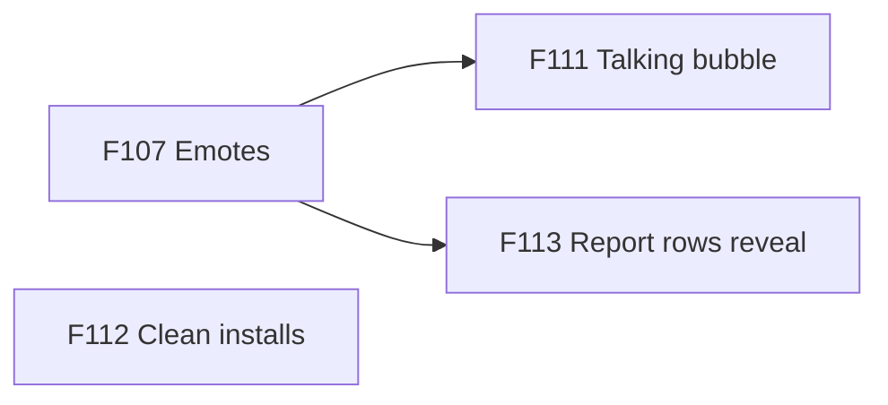

## v0.13 — Games feed the framework  ✅ released 2026-10-24 (v0.15.0) · planned 2026-10-24
Goal (Muzzy 2026-10-24, "yes. go"): a second window pulls finished game pieces out into modules while the game keeps going — just for Muzzy's BMUZ setup.
- ✅ F114 🔧 Extraction queue: a shared queue in the framework repo (game, commit, files, what it does, the e2e checks that prove it); a command to add / list entries; a warning on edits to files being extracted (bug fixes only, logged on the entry); a swap command (install the module, delete the game's copy, run its checks unchanged, one commit); rules in PROJECT-FILES + /develop; a trial on a scratch Goops — should · sprint 30
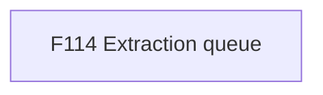

## v0.14 — Story pieces made solid  ✅ released 2026-10-24 (v0.16.0) · planned 2026-10-24
Goal (Muzzy 2026-10-24, /develop on the plan's pick a): the pieces Goops now uses behave well everywhere — a reveal that replays, a bubble every player can follow — and the planner stops needing hand-trimming.
- ✅ F115 ✨ StatList replays its reveal when its rows change (a Modal swapping paydays) — onRevealed once per reveal; no `key` workaround — should · needs: F113 · sprint 31
- ✅ F116 ✨ Talking bubble for every player: one lasting shared announcer so screen readers read each new line (the emote bubbles too), keyboard focus moves to a new bubble, the same line twice restarts, bad talk.json values clamped — should · needs: F111 · sprint 31
- ✅ F117 🔧 plan-lint trims the STATE Log itself: past 10 entries the oldest move to archive/log.md (newest first), said in one line — should · sprint 31
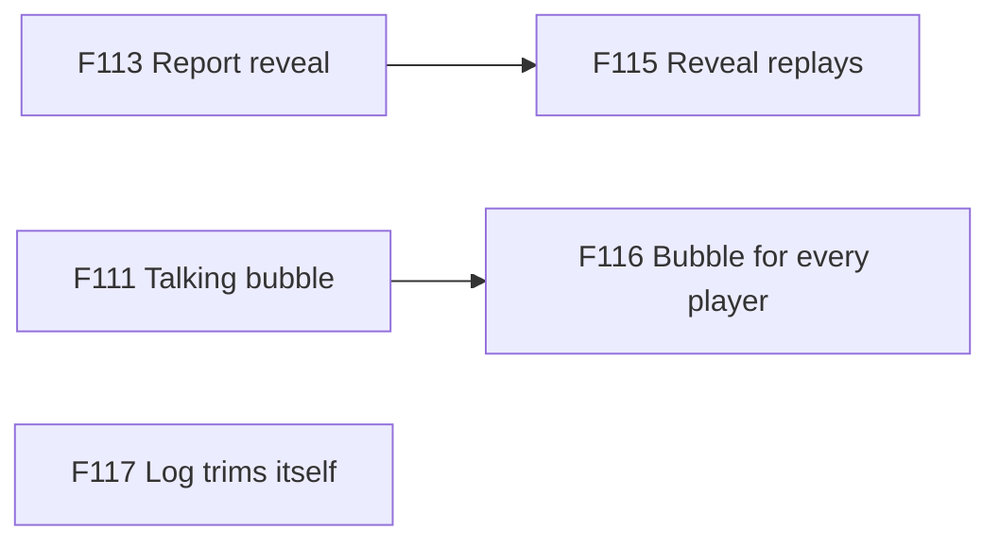

## v0.15 — Checks you can trust  ✅ released 2026-10-24 (v0.17.0) · planned 2026-10-24
Goal (Muzzy 2026-10-24, /develop on the plan's pick a): a red check means a real problem — a busy port says who holds it, the kit's own gallery is clean, and the framework check never builds a command line out of file names.
- ✅ F118 🔧 Port pre-flight in check:full: before any e2e starts, every port it will use is checked; a taken one fails at once with "port N is held by <command> in <folder>" (Goops' session: a leftover vite on 5291 showed up as a meta-tag timeout, two nights) — should · sprint 32
- ✅ F119 🔧 The UI kit gallery passes its own layout checks: the 56 older cut-off names and overlaps (Results names, the Room share line, Feedback toast, lobby, hud) fixed in the kit or its demos, so a new problem stands out — should · sprint 32
- ✅ F120 🔧 check-framework runs commands as an argument list, never one shell string built from file names (security review 2026-10-19, low) — should · sprint 32
- ✅ F121 ✨ TalkingBubble colours from the game's content: `colours` { fill, ink, outline, outlineWidth, more } read live like `feel` (Goops F35 — Muzzy 2026-10-24: "veteran is a light colored bubble with dark text. but you have it as a dark colored bubble with white text."); the style's colours stay the default; a contrast floor — should · needs: F111 · sprint 32
- ✅ F122 🔧 Dev Kit Fonts library lists every installed font: the PC's own font folders (Windows: C:/Windows/Fonts + the user's; mac ~/Library/Fonts + /Library/Fonts; Linux font dirs) join the designer's font folder, server side — no browser permission, any browser, Try + Add to game as today, installed fonts marked 🔴 until their licence is checked (Goops' session idea 2026-10-23) — could · sprint 32
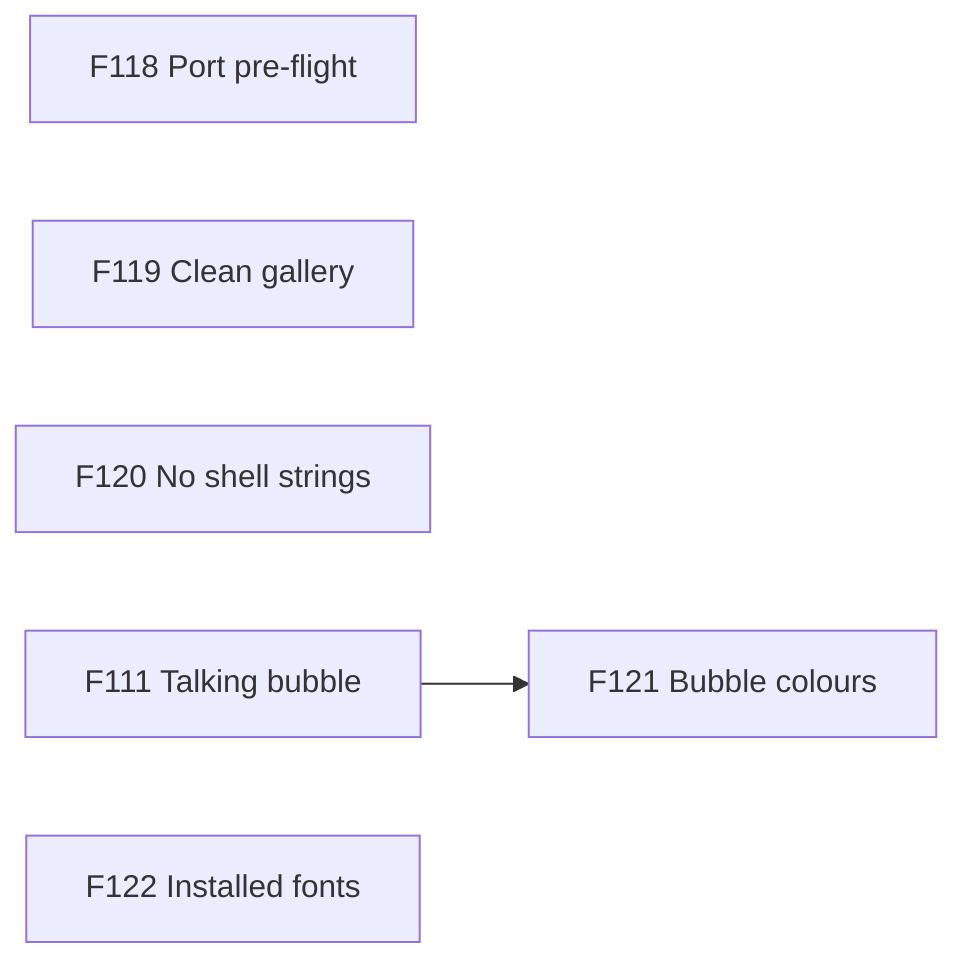

## v0.16 — The kit holds up on a phone  ✅ released 2026-10-24 (v0.18.0) · planned 2026-10-24
Goal (Muzzy 2026-10-24, /sprint pick a): nothing in a HUD slides under its neighbour on a small phone, the page check catches a covered bar, and check:fast stops going red by load.
- ✅ F123 🐞 HUD corner slots keep their content's width: `.kit-screen > [data-slot] { min-inline-size: 0 }` (kit.css) lets a corner shrink and slide under its neighbour — the coins chip on the end of the Health bar (upright Cozy phone), Roll crossing "40%" on a 667×375 phone; fixed in the kit at every size, the middle gives way instead — should · needs: F124 · sprint 33
- ✅ F124 🔧 uiProblems sees a covered bar: a solid chip, badge or panel on top of a bar / meter / art (no text, not a control) counts as an overlap, so F123's kind of bug can't hide — should · sprint 33
- ✅ F125 🔧 The saves install test that times out under load: find what it waits on (5.1 s under check:fast vs 2.3 s for all 10 alone) and fix the cause, not the limit — could · sprint 33
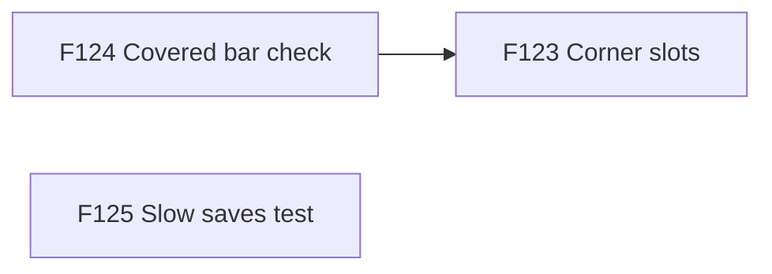

## v0.17 — A clean screenshot run  ✅ released 2026-10-24 (v0.19.0) · planned 2026-10-24
Goal (Muzzy 2026-10-24, /develop on sprint option A): the kit's screenshot run comes back with 0 problems, the page check also sees a chip covering a card's text, and no installer test can time out under load.
- ✅ F127 🔧 uiProblems sees a chip covering text: F124's covered-piece rule also counts a solid chip crossing another card's words (coins over "Score 120"), with the same on-purpose exemptions — should · sprint 34
- ✅ F126 🐞 The shoot's 16 left-over finds → 0: the parts page's HUD demo at 200% text, the talking bubble over the Colours picker on a phone on its side, pinned Pixel 1 px edges — should · needs: F127 · sprint 34
- ✅ F128 🔧 Every installer asks git once per run: the 9 other installers cache their git answer like saves 0.6.2 — could · sprint 34
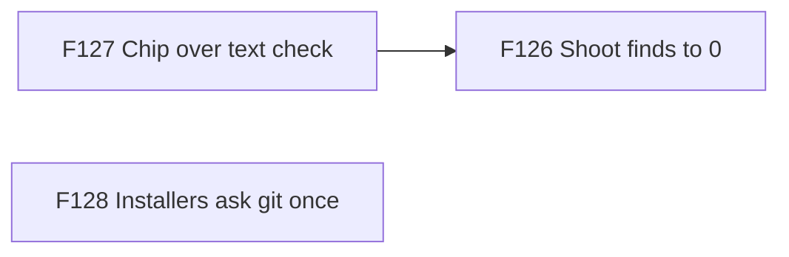

## v0.18 — The kit speaks up  ✅ released 2026-10-24 (v0.20.0) · planned 2026-10-24
Goal (Muzzy 2026-10-24, "A go"): the kit's own tools say so when their result can't be trusted — a screenshot run that saw the code change, a bubble that couldn't stay clear of what it avoids.
- ✅ F129 🔧 The shoot stops on a file change mid-run: an edit while `npm run shoot` runs ends it red, naming the file, so a result is about one version of the code — should · sprint 35
- ✅ F130 🔧 A bubble that can't stay clear says so: TalkingBubble / teach callout / emote bubble print one dev-console warning when no side keeps them off their `avoid` — could · sprint 35
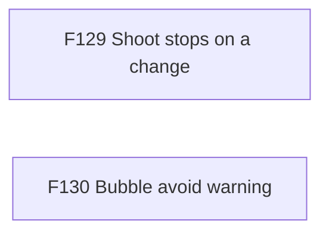

## Later
- **Roll Better gets the safety kit when it comes off the shelf** (F79 checkup, 2026-10-19): reinstall its pieces with install-module (→ check:framework), GitHub checks, check-run lock; its privacy link still points to example.com (F76 check). Kept here, not in its repo: its master publishes the live site on any push
- **Oct 18 list, lower value** (audit 2026-10-19): a guard for wrangler `--persist-to` / a second dev server · new content/*.json → nudge to list it in the TDD · HUB.md machine to-do read at session start · plan-lint checks that a task's named files exist · a lint for raw numbers in game logic (large, noisy) · a knob sweep for sketches
- **AI standard: looks human** (Muzzy 2026-10-05: "when possible, the AI should visually come across as human. If a human would drag, they should too") — every AI action shows the same motion and timing as a person's; write into design/ai.md when Glyphtender's draft fix lands
- 🔧 Theme Tuner sliders in the Dev Kit (playground-style) — should
- Unity twin: sinanata UI Toolkit design system + same layout classes, screen stack, catalog names, style.json — should (when a Unity game needs UI)
- Textured extras (Kenney CC0 9-slice panels) — could
- Dark console + Fantasy presets — could
- Next modules (BMUZ-PLAN step 2): inventory all projects for candidates — Roll Better's online rooms, drag-to-zone, physics dice

## Ideas
- 2026-10-24 — → v0.18 F129. **The shoot ignores a hot reload mid-run** (F126 helper): an edit to a gallery or kit file while `npm run shoot` runs makes Vite reload some screens on new code — the run should fail on Vite's hmr line so its result is about one version of the code.
- 2026-10-24 — → v0.18 F130. **TalkingBubble / Callout `avoid` says nothing when it finds no clear side** (F126): it then covers the element it was told to avoid; a dev-console warning would tell games.
- 2026-10-24 — → v0.17 F126. **🐞 The shoot's 16 left-over finds** (sprint 33, after F123 — none are HUD corners): (1) the parts page's "HUD demo" is a plain Screen, and at 200% text "Round 2" covers part of "Health" — give plain Screens the phone fallback (middle on its own row) or build the demo with Hud; (2) talk screen on a 667×375 phone (and Pixel at 844×390, flickers): the talking bubble covers the "Colours" picker's Next (F121 area); (3) pinned, Pixel, 360×780: 8 `edge:` lines at 1 px. They were already there; F124 and the new shoot sizes made them visible.
- 2026-10-24 — → v0.17 F127. **uiProblems: a solid chip covering another card's text** (found by F124): coins over "Score 120" isn't flagged — the text rule takes the chip for "something covering it". Extend F124's covered-piece rule to text targets.
- 2026-10-24 — → v0.17 F128. **The other installers start git on every install too** (found by F125): install-ai / -audio / -crashes / -devkit / -emotes each run git rev-parse + git status per call, like saves did (2 × 0.2–0.6 s under load) — one shared kitVersion helper asked once per run, before their tests hit the same 5 s limit.
- 2026-10-24 — → v0.16 F125. **saves: the install test that times out under load**: "the Save code screen (ui/) only goes into a game with the UI kit…" took 5.1 s under check:fast's 20 side-by-side checks (2.3 s for all 10 alone) and went red once at /deliver v0.17.0. Find out what it waits on (real file copies? an npm call?) before giving it a longer limit.
- 2026-10-24 — **Retire OLD_MODULE_ROWS for real** (look-back v0.15): its "out in" date has slipped twice (0.33.0 → 0.34.0) because Glyphtender still hasn't reinstalled crashes / emotes / ai. Plan it as a task in Glyphtender's next sprint (reinstall the three, its checks green), then delete the fallback in UI kit 0.34.0 — and give each game the F118 port pre-flight (check-all + `scripts/ports.mjs`) in the same pass.
- 2026-10-24 — → v0.16 F123 + F124. **🐞 UI kit: a corner slot can shrink below its content** (found by F119): `.kit-screen > [data-slot] { min-inline-size: 0 }` lets a HUD corner slide under its neighbour — the coins chip sits on the end of the Health bar on an upright Cozy phone, and on a 667×375 phone the sample's Roll crosses "40%". And the page check misses it: an opaque chip covering a bar (no text, not a control) isn't an overlap it looks for — teach uiProblems that, then fix the slot rule.
- 2026-10-23 — **Hand to Glyphtender's session (found by the F25 / F26 proofs, scratch copy only):** (1) "What wins?" says players with LESS room to move win more (the Strategist keeps the most room and wins ~20%) — "glyphling freedom" may not be what wins; (2) the Strategist's "tangles a rival in ≥ 60% of games" barely moves with its sliders (the tuner's best held at 0.53 on 120 fresh games) — the gap is in its TRAP goal or the target's number; (3) set `tuneGames` 30 in its own content/ai/arena.json when it installs ai 0.7.0 (12 a try was luck twice there).
- 2026-10-23 — **Small AI-report choices left at their defaults** (Muzzy approved F25/F26 without picking): "of N games" counts each player's game once (17lands style) — "player-games" would be plainer; `ai:tune` on the PC could default to 30 games a try while the Dev Kit button stays quick. Pick when a game first uses them.
- 2026-10-23 — ✅ done in F110 (UI kit 0.30.0, settings-rows.json; noticed 2026-10-24). **A module's Settings row registers itself** (v0.5 look-back): crashes, emotes and ai each copied the same row + save pattern, and the UI kit's Settings check had to learn each new key by hand (`hideEmotes`, `botChatter`) — one shared "module settings row" shape the check reads, so a new module needs no UI kit change.
- 2026-10-23 — **A tappable seat row in the UI kit** (v0.5 look-back): emotes need one tappable portrait per seat; the scratch Glyphtender had to hand-build `SeatEmotes.tsx` — a kit part (seats in a row, each with `emoteSeatProps` + the muted mark) so every game with opponents gets it.
- 2026-10-23 — **BMUZ rule: game ↔ framework sessions message each other** (Goops' session, its Sprint 12 retro): a game session needing a framework change messages the framework session directly (what + why + evidence, "don't install until done"), the framework session replies "done" + the install-module command, the game confirms; the request is also written in the game's STATE/SPRINT Notes; neither asks the other to do what its own rules block. F108 went ask → installed in ~1 h this way. Muzzy OK'd 2026-10-23 → landed in config/bmuz/PROJECT-FILES.md "Game ↔ framework sessions talk directly".
- 2026-10-22 — **Hand to Glyphtender's session (found by the F24 proof, read-only):** its own `scripts/ai-arena.mjs` seats every 2-player table as Scholar vs Survivor, so the Strategist never plays 2-player (0% wins there vs 20% with a fair shuffle), and its Dev Kit check seats tables another way — switching to the framework arena (ai 0.3.0: `npm run ai:arena`, `src/ai/arenaGame.ts`) fixes both; the installer names its old `ai:arena` line.
- 2026-10-21 — **Audio: more spike shaving for very short clicks?** (F31 listen: Muzzy liked 6 dB of shaving on the 60 ms tank spin, 3.5 on the others) — if more short sounds want it, a per-file or "short sounds" maxLimitingDb in content/audio.json.
- **Store release run-through** (Muzzy 2026-10-20: "when i'm ready to actually release games… a big runthrough with you to get app store, play store, steam and itch.io (and any other platforms) figured out") — accounts, fees, store pages, signing, a real Steam Cloud test of F97; until then games go out on GitHub Pages only — could
- 2026-10-20 — **Replays for Goops and Roll Better** (found planning F94): Goops needs a fixed game step (its tick takes the frame's real time) and its repair minigames' Math.random checked; Roll Better needs seeded dice instead of physics results trusted from the browser. Then both can use the saves replay piece + leaderboards.
- 2026-10-19 — **Hand to Roll Better's session (found by F85's checkup §8, read-only):** `@react-three/rapier@2.2.0` ships with no licence in its package — its next release is refused until the licence is checked (repo likely MIT, unverified) and --deps-risk-ok chosen, or upstream adds one. Also 9 outdated shipped packages.
- 2026-10-19 — **Patch notes, later (F84 research):** Steam BBCode + store short forms with their limits (Play 500, App Store 4,000) · an in-game "What's new" (once after an update, highlights only, never on first install or mid-game).
- 2026-10-19 — **Packages, later (F85 research):** npm 12 blocks dependencies' install scripts — test esbuild / Playwright / sharp first · Dependabot with a cooldown + grouped monthly PRs once several games are live · turn on GitHub's free security alerts per repo.
- 2026-10-19 — **Saves switch-over, per game (F86 proof, scratch copies):** Goops → install `saves`, goops-progress becomes a createSave (progress, v1, `oldSave` for the old {v:1} record, both fields highest), golden saves v1 + v1-module, `setSavesConfig` in main.tsx, later the Settings rows + `askToKeepSaves()`. Glyphtender → install, glyphtender:new-game v2 with the 2-letter upgrade step, golden saves v1/v2/v2-module, room code under `storageAllowed` until F95, Settings rows + Save code screen; still to move: onlineOptions.ts (same 2-letter marker), tutorial/progress.ts, wordOutbox.ts; fullscreen.ts under `storageAllowed`. Steps in `saves/README.md`.
- 2026-10-19 — **Saves: after a part-way code import, reload the game** (review): the panel says which saves came back but the running game still shows the old values until a reload.
- 2026-10-19 — **Saves: test on real Safari, Firefox, a real itch.io page and a real incognito window** — Playwright Chromium only so far; the private-window guess may never fire in Chrome (same quota as a normal profile).
- 2026-10-19 — **Hand to Goops' session (found by F88, read-only on a scratch copy):** the new quality bars pass; 5 older gaps — 27 art files not in credits, 2 🔴 fonts (gb_boot, Press Start DX), no code reads content/credits.json, Settings "Version" row has no text, no `conformance.startPlay` in the adapter (only the first screen gets checked).
- 2026-10-19 — **Hand to Goops' session (found by today's plan-lint fix, read-only):** F33, F49, F53 are ⏳ but everything they need is done — set them 🟢 (or add `· waits: <what>`).
- 2026-10-19 — **Hand to Goops' session (found by F87, read-only):** its sprint 08 features F30 + F32 have no `Check:` line (their test plan) — plan-lint names them at its next plan edit, and `F30: done` / `F32: done` will need a `Checked:` line.
- 2026-10-18 — **Hand to the game sessions (found by F67's new checks, read-only):** Glyphtender — F31–F36 + F46 `needs:` hidden by a later " — " (planner shows none), B026 used twice, B024 verified but under Open, Open count off · Goops — tasks under "## Play-test fixes" in SPRINT.md don't show in the planner (the sprint-05 problem again), F02b/F15 done but need F02, F27 ❓ with 4 tasks, 26 own-art files not in credits.json, 2 fonts marked 🔴 still in public/, no code reads credits.json · Roll Better — 7 fixed bugs under Open, Log 22 entries, favicon + 2 app icons not in credits.json. Each session: `node ~/.claude/config/bmuz/hooks/plan-lint.mjs .` and `npm run check:framework -- --static` (UI kit 0.19+).
- 2026-10-18 — **UI kit gallery fails the new overlap / cut-off checks** (F61): `npm run shoot` found 63 overlaps + 34 cut-off texts in the kit's own demos before the overlap fix (e.g. the HUD demo's "HOLD TO ROLL" banner over the player cards on a Pixel landscape phone; "Muz…" cut off on End game, landscape) — recount on UI kit 0.18.1, then fix the kit so games start clean.
- 2026-10-14 — → v0.8 F55–F57 (defined 2026-10-14). **Dev Kit Select Mode** (Muzzy: "This functionality makes Dev Kit incredibly strong"): a "Select" tab that toggles a select mode — hover = thin pink outline, click = thick outline (a transparency slider at the top, saved in the Dev Kit's own settings); it gathers every attribute ACROSS tabs (Tuning · Text · Colours · Sound) tied to that object into one filter that STAYS after leaving select mode, so you play and tweak it live. Claude's notes: the hard part is the object → attributes map (values are read in code, not on the DOM) → explicit tags (`data-devkit="anim.glide feel.landing …"`, a check fails on a tag naming a missing key; a BMUZ checklist line: new tunable → tag its object) over auto-tracking reads; clicks caught capture-phase like Glyphtender's Explore mode (F79, reuse it); freeze + a "recently on screen" list for things that flash by (score pops, a flying seed, callouts); "affects all 8 glyphlings" for shared values; "select parent" (glyphling → board → screen); same editors + same files (one source of truth); outline in its own layer (never shifts layout); a "Copy for Claude" of the selection; 3D games later need a raycast picker + 3D outline (same tab, other picker). Muzzy's calls (2026-10-14): NO freeze — a collapsible "recently on screen" list instead · NO "select parent" ("the thing I see and the thing that's actually being controlled are not always the same… My goal is the simplicity of click on a thing > see the attributes associated with it compiled in one place > update those things and hit save") — so tags are written by MEANING on what you see (the glyphling lists "lift height" even though a drag copy is what lifts) · plan for 3D, build it later ("this could be a rabbit hole") · worry: big things (a zone, the board) touch dozens of values → a short chosen list per object, grouped by section. Smallest version: Select tab + pink hover/selected outline + its slider, tags on 10–15 key objects, the recent list. Next: /discover, starting with that object → knobs list WITH Muzzy.
- 2026-10-10 — **Dev Kit Save un-wrapped a hand-wrapped list** (Glyphtender drag.json `_sections`: a 2-line array became 18 lines on Muzzy's first Save) — readLayout (0.6.1) keeps one-line vs spread-out, but not a list wrapped by hand across a few lines. Harmless, but it buries the real change in `git diff`.
- 2026-10-10 — → F53, F54 (v0.7). **Drag carry styles** (Muzzy, from Glyphtender: dragging a draft glyphling or a seed leaves a SOLID copy in the tray — two real-looking pieces): the drag referee / Hand view gets a per-zone (or per-phase) carry style — carried solid|ghost × origin solid|ghost|empty — named A Pick it up (solid · empty), B Lift, mark home (solid · ghost), C Aim (ghost · solid; on a valid drop the real piece flies from origin to target), D Float (ghost · empty); plus how a valid drop lands (settle / turn solid / fly from origin) and how an invalid one returns (fly back from the cursor / fade). All exist; each game picks per phase; a Dev Kit switch previews them live on the real board. Muzzy: "I want to see the options first" — chart given 2026-10-10; Glyphtender guess: draft = A, plan a cast = C (or B), tray reorder = A/B. **Also (Muzzy + Claude 2026-10-10):** the TARGET side — highlight (today) · a ghost preview at the landing spot · an INSERTION MARKER between two items (Muzzy's card-hand case: a graphic, not the card) · neighbours MAKE ROOM (slide apart) · a tether/aim arrow from origin to cursor (Hearthstone/StS); lift feedback (scale + shadow, any style); magnetic snap near a valid spot; tap-then-tap already exists. Three axes: what you carry (A–D) × what the target shows × how it ends. Muzzy: solve tiles/objects in zones FIRST (next sprint) — groundwork for hands (insertion/make-room) in a near-future card game.
- 2026-10-08 — **Dev Kit can't edit content/rooms.json** (Glyphtender F52): its Tuning tab only lists content/tuning/*.json, so room knobs (idleWarnAfterMs, idleTakeoverAfterMs…) are file/Obsidian only — let the Tuning tab take extra files (and say "restart party:dev" for server-bundled ones).
- 2026-10-08 — ✅ done in kit 0.6.0 (2026-10-12: no partykit.json at all — wrangler.json + party/worker.ts are the standard). **rooms installer made partykit.json even for wrangler games** (Glyphtender F52 deleted it).
- 2026-10-04 — ui-kit `npm run shoot` times out on the `pause` screen (it waits for the FIRST `.kit-screen`, which under Pause is the hidden HUD — wait for a visible one instead). Also: shoot uses port 5180 with strictPort, the same port Glyphtender's /play server uses — give it its own port. (Found by the HandView helper, autonomous run.)
- 2026-09-28 — UI kit nitpicks to fix when a game uses them: Mode select leaves an empty 4th column on desktop · toasts briefly cover the gallery bar · gamepad-only games show the focus ring only after the first key press · does VT323 still feel "Pixel"? · "Accessibility" breaks mid-word in ◀ ▶ at 200%
- 2026-09-28 — Kit additions expected from a full Roll Better UI pass: "game box" mode (screens/HUD inside a fixed-aspect frame, not the window) · Lobby seat-claim list (rejoin) · kit parts inside drei <Html> labels pinned to 3D
- 2026-09-29 — Kit review nits: landscape MainMenu counts only items/named buttons toward "6 → two columns" (extra child buttons don't count) · check-ui --css splits on ';' (false warning on data: URLs) · MainMenu `children && …` would render a stray 0
