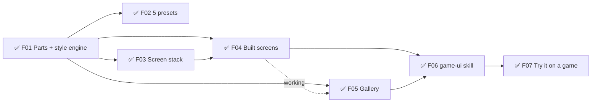
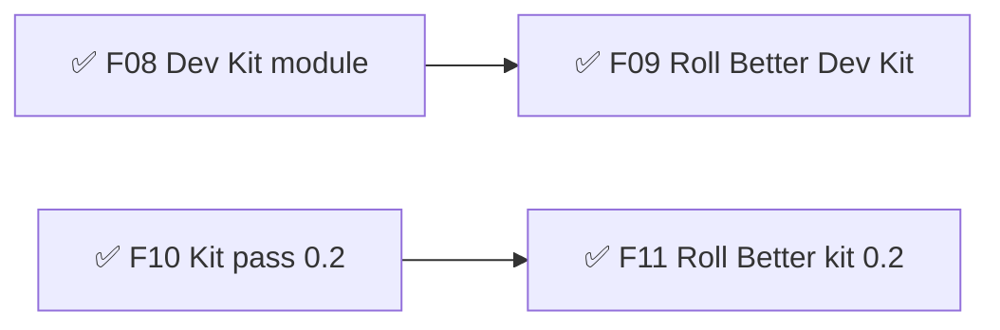
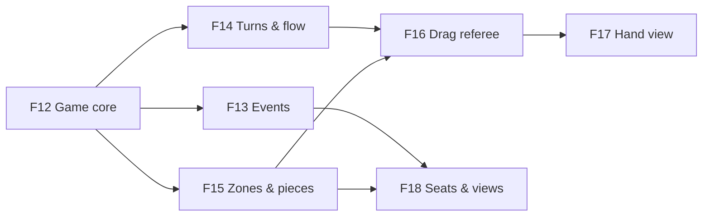
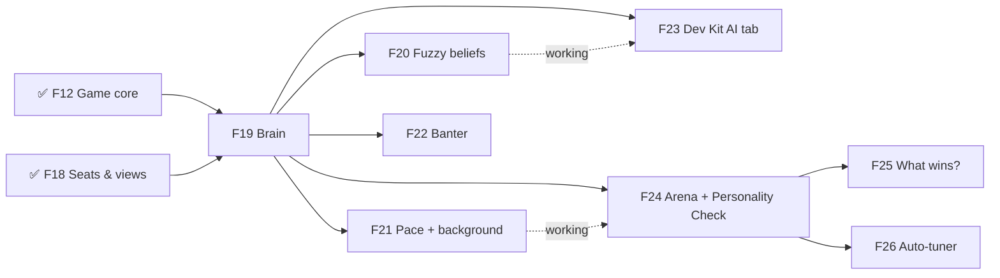
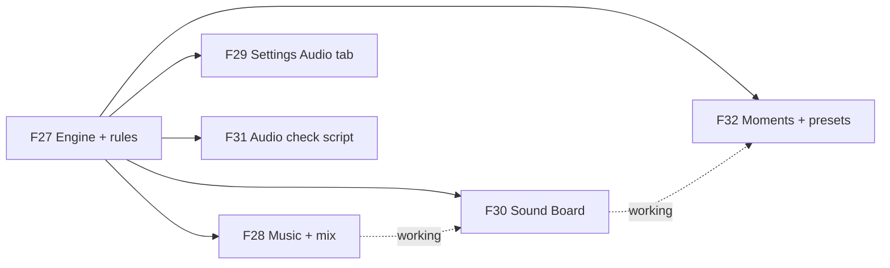

# Game Framework — Roadmap
Release target: v0.5 The AI (defined 2026-10-04, proven by Glyphtender beta) — musts 2/6 · v0.4.0 The Table released 2026-10-04

## v0.1 — Game UI kit  ✅ released (prototype) 2026-09-28
Goal: any game can get good-looking, standard menus, settings, dialogs and HUD in one of 5 styles, built passively by the `game-ui` skill. Design: `design/ui-kit.md`.
- ✅ F01 🧱 Parts + style engine — must:prototype · sprint 1
  what: 5 layout boxes (Screen, Panel, Stack, Row, Grid), the controls, style.json → CSS variables at runtime, accessibility floor, preset test
- ✅ F02 🎮 5 style presets (Clean, Cozy, Cartoon, Pixel, Neon) — must:prototype · needs: F01 · sprint 1
  why: one structure, many skins → every game looks finished from day one → less look-and-feel back-and-forth
- ✅ F03 🧱 Screen stack + transitions — must:prototype · needs: F01 · sprint 1
- ✅ F04 🎮 Built screens: menu, list-driven settings, pause, dialogs, loading, flow/results, lobby, HUD frame + pieces — must:prototype · needs: F01, F03 · sprint 2
- ✅ F05 🔧 Gallery app (every catalog entry × every preset; phone + desktop screenshots; style switcher) — must:prototype · needs: F01, ~F04 · sprint 2
- ✅ F06 🧱 `game-ui` skill + recipe catalog + wiring into /develop and /define — must:prototype · needs: F04, F05 · sprint 3
- ✅ F07 ❓ Try it: pick a game + a real screen to rebuild; adjust from what we learn — needs: F06 · sprint 3

## v0.2 — Dev Kit module + kit pass  ✅ released (prototype) 2026-09-29
Goal: every web game gets the in-game Dev Kit (` key) from the framework, and the UI kit closes the gaps Roll Better found.
- ✅ F08 🧱 Dev Kit module (`devkit/`: panel, Save/Copy for Claude, release switch, colour tab, game-tab API, installer, release check) — must:prototype · sprint 4
  why: every game gets the same tuning tools on day one → taste calls happen by eye in the game, not by description
- ✅ F09 🔧 Roll Better on the framework Dev Kit (table felt becomes its game tab) — must:prototype · needs: F08 · sprint 4
- ✅ F10 ✨ Kit pass 0.2: MainMenu item list, Results dim, toast placement, Bar width, PlayerChip xs, pinned-part scale helper, check-ui scans game CSS — must:prototype · sprint 4
- ✅ F11 🔧 Roll Better on kit 0.2 (remove its stitches) — must:prototype · needs: F10 · sprint 4

## v0.3 — Rooms, Dev Kit 0.5, kit 0.2.15  ✅ released 2026-10-03 (v0.3.0 → v0.3.1, built through Glyphtender)
Shipped while Glyphtender used them (backfilled 2026-10-04): **Rooms** module (online rooms, seats, rejoin, bot takeover, per-player views — harvested from Roll Better, proven in Glyphtender) · **Dev Kit 0.3–0.5** (snapshots, bug capture, screen previews, search + sections) · **UI kit 0.2.3–0.2.15** (screen stack, carousel that loops, cards that breathe, no orphans, PlayerChip floatUps…).

## v0.4 — The Table  (proven by Glyphtender v0.6)  ✅ released 2026-10-04
Goal: the foundation every board/tabletop game stands on — Game core + events, Turns & flow, Zones & pieces, drag referee, Hand view, seats & per-seat views — built for online play and AI (local and online). Design: `design/table.md`. Each feature is built here first and switched on in Glyphtender the same sprint (its F29–F36); Roll Better is the second-game proof after.
- ✅ F12 🧱 Game core: rules contract (setup, legalActions, check, apply → state + events, isOver, viewFor), replayable move record, fast mode, seeded random — must:prototype · needs: Glyphtender F29 (golden games) · built in table/ (kit 0.1.0), switched over in Glyphtender sprint 09
- ✅ F13 🧱 Event stream: events with visibility; listeners for screen, sound, stats, achievements, online replay — must:prototype · needs: F12
- ✅ F14 🧱 Turns & flow: stack of named levels, who may act (one · some/all · everyone), order list from the rules, ends-when, response windows; presets — must:prototype · needs: F12
- ✅ F15 🧱 Zones & pieces: zones (nesting, inherited owner/visibility), pieces with stable ids, owner field, shared vs local states, accepts by kind — must:prototype · needs: F12
- ✅ F16 🧱 Drag referee: one acceptance answer → glow, piece reaction, nope, cursor; phones show valid zones on pick-up; server re-check — must:prototype · needs: F14, F15
- ✅ F17 🧱 Hand view: zone layouts with presets (rack first; fan later) — must:prototype · needs: F16
- ✅ F18 🧱 Seats & per-seat views: one seat model (human/bot, local/online), viewer seat for pass-and-play, per-seat views + per-seat events in Rooms (replaces broadcast-to-all), leak tests — must:prototype · needs: F13, F15

## v0.5 — The AI  ← current  (proven by Glyphtender beta, its v0.7)
Goal: any turn-based game can put a fair, human-feeling AI in any seat — local or online — with personalities Muzzy tunes in the Dev Kit and proves by watching behaviour across hundreds of games. Design: `design/ai.md`. Built here first and switched on in Glyphtender the same sprint (its F38–F47).
- ✅ F19 🧱 Brain: personality + skill data, see (view only) → imagine hidden → readings → mood shifts → goal roll → candidates → score (main goal + nudge) → choose like a person → explain note; seeded; game plug shape — must:beta · needs: F12, F18 · Glyphtender sprint 14 · built 2026-10-04 (ai kit 0.1.0)
- ✅ F20 🧱 Fuzzy beliefs: estimates with confidence that decays / rises from the seat's own events; drift; rebuilt from events (rejoin-safe) — must:beta · needs: F19, F13 · built 2026-10-04 (stateless beliefs.ts)
- ✅ F21 🧱 Pace + background thinking: Web Worker runner, time budget, think-time + speed presets (Slow · Normal · Fast · Instant), server runner inside the room — must:beta · needs: F19
- 🔨 F22 🧱 Banter: moments from events → line picker (chattiness, cooldown, no repeats) + UI kit SpeechBubble part — must:beta · needs: F19, F13
- ✅ F23 🔧 Dev Kit AI tab: personality editor (range sliders, goal order, nudge, shifts, skill, bio/banter) saving to content/ai/, and "watch a game" with decision notes + belief meters — must:beta · needs: F19, ~F20 · built 2026-10-04 (Dev Kit 0.6.0, devkit/kit/ai: game plugs in with aiTab(DevKitAi) — files as data + validate / watch / runCheck callbacks; Run check opens the F24 report; first game: Glyphtender F41). Not yet: banter lines, pace.json, pause/step in Watch
  why: Muzzy tunes personalities by eye in the game, not by description
- 🔨 F24 🔧 Arena + Personality Check: N AI-vs-AI games (Node + Dev Kit), behaviour meters, feel targets green/red, tell-apart grid, win-rate grid, skill ladder, report page — must:beta · needs: F19, ~F21
  why: proves a personality *feels* like itself (behaviour), not just that its numbers are set
- ⏳ F25 🔧 "What wins?" report: which situations predict winning, from self-play — should · needs: F24
- ⏳ F26 🔧 Auto-tuner: suggests slider values that hit a personality's feel targets — could · needs: F24

## v0.6 — Audio  ✅ released 2026-10-10 in framework v0.5.0 (proven by Glyphtender v0.6.0)
Goal: any web game gets sound by naming its moments — content/audio.json says what they sound like, Muzzy tunes and swaps them in the Dev Kit Sound Board, and the standards (volume groups, variation, limits, phones, online catch-up) come for free. Design: `design/audio.md`. Defined with Muzzy 2026-10-09.
- ✅ F27 🧱 Audio engine + rules: pure planner (variants, random pitch/volume, voices + cooldown + priority, pitch ladder, stale/catch-up drop), Web Audio engine (unlock, buses → limiter, silent switch, hidden/interrupted = drop not queue, mono, snapshots + ducking), loader (decode sfx, stream music), content/audio.json config + validation, log (window.__audioLog), React helpers, installer; audio-setup skill → points at the module — must:beta · needs: —
  status 2026-10-09 (Glyphtender sprint 19): built in audio/ (kit 0.1.0), tests pass (90) — planner, engine, loader (decode only), config, log, settings, React helpers, installer. Left: music streaming via <audio> (moved to F28), audio-setup skill pointer, the Glyphtender proof
- ✅ F28 🧱 Music + mix: streaming long music/ambience through <audio> (F27 decodes everything for now), synced layers, gapless loop points, crossfades, stingers, rests after N loops, snapshot/duck timing — must:beta · needs: F27
- ✅ F29 🎮 UI kit Settings → Audio tab standard: Master · Music · Ambience · Effects · UI · Mute everything · Mute in background · Mono, dB-feel sliders, wired to the engine — must:beta · needs: F27
  status 2026-10-09: ui-kit 0.4.1 standard rows built, tests pass; the dB-feel curve + wiring are the audio module's useAudioSettings. Left: the Glyphtender proof
- ✅ F30 🔧 Dev Kit Sound Board: sound list + ▶ / ▶×5, every knob as sliders (live, Save, ↺), files (drop to replace → public/audio, waveform trim/loop handles), A/B, ▶ in context (game adapter), mixer + meters, play/drop log, credits nudge; binary save endpoint (public/audio only, dev only) — must:beta · needs: F27, ~F28
  why: Muzzy tunes sound by ear in the game ("I should be able to change sounds, tweak them")
- ⏳ F31 🔧 Audio check script: loudness report + convert/normalize to MP3 (ffmpeg-static) + onset check (a tap/ui sound that takes > 15 ms to start is trimmed to its onset — Glyphtender B026), used by the Sound Board's drop — should · needs: F27
- ✅ F32 🔧 Dev Kit Moments + feel presets (Muzzy 2026-10-09): Screens → pick a screen → its Moments (score pop, two-birds, tangle, reveal winner…) → ▶ fire / 🔁 loop while sliders change (feel tiers, timings, sound); each moment has a 3-style preset picker (research the styles other games use first — e.g. Soft · Balanced · Punchy) that sets all its values, then every slider stays tweakable — must:beta · needs: F27, ~F30
  why: Muzzy picks feel by watching it loop, not by reading numbers; presets are the easy start (like the UI kit's 5 styles)

## Later
- **Emote module** (Muzzy 2026-10-05): players send predefined messages (MTG Arena / Hearthstone style); the AI module plugs in its triggers + frequency (AI F22) — could
- **AI standard: looks human** (Muzzy 2026-10-05: "when possible, the AI should visually come across as human. If a human would drag, they should too") — every AI action shows the same motion and timing as a person's; write into design/ai.md when Glyphtender's draft fix lands
- 🔧 Theme Tuner sliders in the Dev Kit (playground-style) — should
- Unity twin: sinanata UI Toolkit design system + same layout classes, screen stack, catalog names, style.json — should (when a Unity game needs UI)
- Textured extras (Kenney CC0 9-slice panels) — could
- Dark console + Fantasy presets — could
- Next modules (BMUZ-PLAN step 2): inventory all projects for candidates — Roll Better's online rooms, drag-to-zone, physics dice

## Ideas
- 2026-10-10 — **Drag carry styles** (Muzzy, from Glyphtender: dragging a draft glyphling or a seed leaves a SOLID copy in the tray — two real-looking pieces): the drag referee / Hand view gets a per-zone (or per-phase) carry style — carried solid|ghost × origin solid|ghost|empty — named A Pick it up (solid · empty), B Lift, mark home (solid · ghost), C Aim (ghost · solid; on a valid drop the real piece flies from origin to target), D Float (ghost · empty); plus how a valid drop lands (settle / turn solid / fly from origin) and how an invalid one returns (fly back from the cursor / fade). All exist; each game picks per phase; a Dev Kit switch previews them live on the real board. Muzzy: "I want to see the options first" — chart given 2026-10-10; Glyphtender guess: draft = A, plan a cast = C (or B), tray reorder = A/B. **Also (Muzzy + Claude 2026-10-10):** the TARGET side — highlight (today) · a ghost preview at the landing spot · an INSERTION MARKER between two items (Muzzy's card-hand case: a graphic, not the card) · neighbours MAKE ROOM (slide apart) · a tether/aim arrow from origin to cursor (Hearthstone/StS); lift feedback (scale + shadow, any style); magnetic snap near a valid spot; tap-then-tap already exists. Three axes: what you carry (A–D) × what the target shows × how it ends. Muzzy: solve tiles/objects in zones FIRST (next sprint) — groundwork for hands (insertion/make-room) in a near-future card game.
- 2026-10-08 — **Dev Kit can't edit content/rooms.json** (Glyphtender F52): its Tuning tab only lists content/tuning/*.json, so room knobs (idleWarnAfterMs, idleTakeoverAfterMs…) are file/Obsidian only — let the Tuning tab take extra files (and say "restart party:dev" for server-bundled ones).
- 2026-10-08 — **rooms installer makes partykit.json even for wrangler games** (Glyphtender F52 deleted it) — skip it when wrangler.json exists.
- 2026-10-04 — ui-kit `npm run shoot` times out on the `pause` screen (it waits for the FIRST `.kit-screen`, which under Pause is the hidden HUD — wait for a visible one instead). Also: shoot uses port 5180 with strictPort, the same port Glyphtender's /play server uses — give it its own port. (Found by the HandView helper, autonomous run.)
- 2026-09-28 — UI kit nitpicks to fix when a game uses them: Mode select leaves an empty 4th column on desktop · toasts briefly cover the gallery bar · gamepad-only games show the focus ring only after the first key press · does VT323 still feel "Pixel"? · "Accessibility" breaks mid-word in ◀ ▶ at 200%
- 2026-09-28 — Kit additions expected from a full Roll Better UI pass: "game box" mode (screens/HUD inside a fixed-aspect frame, not the window) · Lobby seat-claim list (rejoin) · kit parts inside drei <Html> labels pinned to 3D
- 2026-09-29 — Kit review nits: landscape MainMenu counts only items/named buttons toward "6 → two columns" (extra child buttons don't count) · check-ui --css splits on ';' (false warning on data: URLs) · MainMenu `children && …` would render a stray 0
