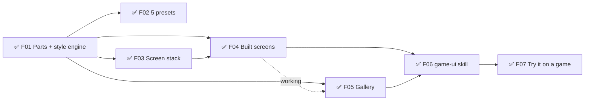
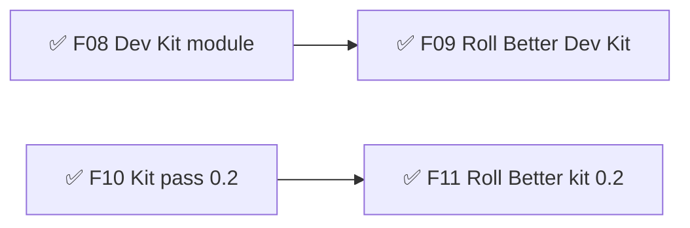
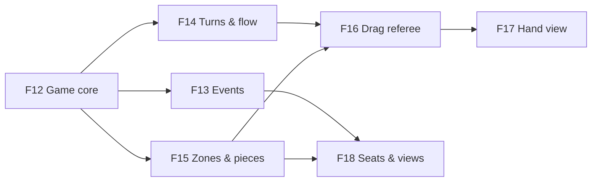

# Game Framework — Roadmap
Release target: v0.4 The Table (0/7) — v0.3.1 released 2026-10-03

## v0.1 — Game UI kit  ✅ released (prototype) 2026-09-28
Goal: any game can get good-looking, standard menus, settings, dialogs and HUD in one of 5 styles, built passively by the `game-ui` skill. Design: `design/ui-kit.md`.
- ✅ F01 🧱 Parts + style engine — must:prototype · sprint 1
  what: 5 layout boxes (Screen, Panel, Stack, Row, Grid), the controls, style.json → CSS variables at runtime, accessibility floor, preset test
- ✅ F02 🎮 5 style presets (Clean, Cozy, Cartoon, Pixel, Neon) — must:prototype · needs: F01 · sprint 1
  why: one structure, many skins → every game looks finished from day one → less look-and-feel back-and-forth
- ✅ F03 🧱 Screen stack + transitions — must:prototype · needs: F01 · sprint 1
- ✅ F04 🎮 Built screens: menu, list-driven settings, pause, dialogs, loading, flow/results, lobby, HUD frame + pieces — must:prototype · needs: F01, F03 · sprint 2
- ✅ F05 🔧 Gallery app (every catalog entry × every preset; phone + desktop screenshots; style switcher) — must:prototype · needs: F01, ~F04 · sprint 2
- ✅ F06 🧱 `game-ui` skill + recipe catalog + wiring into /develop and /define — must:prototype · needs: F04, F05 · sprint 3
- ✅ F07 ❓ Try it: pick a game + a real screen to rebuild; adjust from what we learn — needs: F06 · sprint 3

## v0.2 — Dev Kit module + kit pass  ✅ released (prototype) 2026-09-29
Goal: every web game gets the in-game Dev Kit (` key) from the framework, and the UI kit closes the gaps Roll Better found.
- ✅ F08 🧱 Dev Kit module (`devkit/`: panel, Save/Copy for Claude, release switch, colour tab, game-tab API, installer, release check) — must:prototype · sprint 4
  why: every game gets the same tuning tools on day one → taste calls happen by eye in the game, not by description
- ✅ F09 🔧 Roll Better on the framework Dev Kit (table felt becomes its game tab) — must:prototype · needs: F08 · sprint 4
- ✅ F10 ✨ Kit pass 0.2: MainMenu item list, Results dim, toast placement, Bar width, PlayerChip xs, pinned-part scale helper, check-ui scans game CSS — must:prototype · sprint 4
- ✅ F11 🔧 Roll Better on kit 0.2 (remove its stitches) — must:prototype · needs: F10 · sprint 4

## v0.3 — Rooms, Dev Kit 0.5, kit 0.2.15  ✅ released 2026-10-03 (v0.3.0 → v0.3.1, built through Glyphtender)
Shipped while Glyphtender used them (backfilled 2026-10-04): **Rooms** module (online rooms, seats, rejoin, bot takeover, per-player views — harvested from Roll Better, proven in Glyphtender) · **Dev Kit 0.3–0.5** (snapshots, bug capture, screen previews, search + sections) · **UI kit 0.2.3–0.2.15** (screen stack, carousel that loops, cards that breathe, no orphans, PlayerChip floatUps…).

## v0.4 — The Table  ← current  (proven by Glyphtender v0.6)
Goal: the foundation every board/tabletop game stands on — Game core + events, Turns & flow, Zones & pieces, drag referee, Hand view, seats & per-seat views — built for online play and AI (local and online). Design: `design/table.md`. Each feature is built here first and switched on in Glyphtender the same sprint (its F29–F36); Roll Better is the second-game proof after.
- 🔨 F12 🧱 Game core: rules contract (setup, legalActions, check, apply → state + events, isOver, viewFor), replayable move record, fast mode, seeded random — must:prototype · needs: Glyphtender F29 (golden games) · built in table/ (kit 0.1.0), switched over in Glyphtender sprint 09
- ⏳ F13 🧱 Event stream: events with visibility; listeners for screen, sound, stats, achievements, online replay — must:prototype · needs: F12
- ⏳ F14 🧱 Turns & flow: stack of named levels, who may act (one · some/all · everyone), order list from the rules, ends-when, response windows; presets — must:prototype · needs: F12
- ⏳ F15 🧱 Zones & pieces: zones (nesting, inherited owner/visibility), pieces with stable ids, owner field, shared vs local states, accepts by kind — must:prototype · needs: F12
- ⏳ F16 🧱 Drag referee: one acceptance answer → glow, piece reaction, nope, cursor; phones show valid zones on pick-up; server re-check — must:prototype · needs: F14, F15
- ⏳ F17 🧱 Hand view: zone layouts with presets (rack first; fan later) — must:prototype · needs: F16
- ⏳ F18 🧱 Seats & per-seat views: one seat model (human/bot, local/online), viewer seat for pass-and-play, per-seat views + per-seat events in Rooms (replaces broadcast-to-all), leak tests — must:prototype · needs: F13, F15

## Later
- 🔧 Theme Tuner sliders in the Dev Kit (playground-style) — should
- Unity twin: sinanata UI Toolkit design system + same layout classes, screen stack, catalog names, style.json — should (when a Unity game needs UI)
- Textured extras (Kenney CC0 9-slice panels) — could
- Dark console + Fantasy presets — could
- Next modules (BMUZ-PLAN step 2): inventory all projects for candidates — Roll Better's online rooms, drag-to-zone, physics dice

## Ideas
- 2026-09-28 — UI kit nitpicks to fix when a game uses them: Mode select leaves an empty 4th column on desktop · toasts briefly cover the gallery bar · gamepad-only games show the focus ring only after the first key press · does VT323 still feel "Pixel"? · "Accessibility" breaks mid-word in ◀ ▶ at 200%
- 2026-09-28 — Kit additions expected from a full Roll Better UI pass: "game box" mode (screens/HUD inside a fixed-aspect frame, not the window) · Lobby seat-claim list (rejoin) · kit parts inside drei <Html> labels pinned to 3D
- 2026-09-29 — Kit review nits: landscape MainMenu counts only items/named buttons toward "6 → two columns" (extra child buttons don't count) · check-ui --css splits on ';' (false warning on data: URLs) · MainMenu `children && …` would render a stray 0
